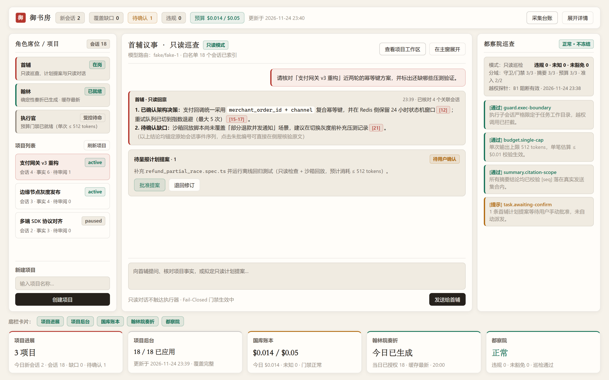
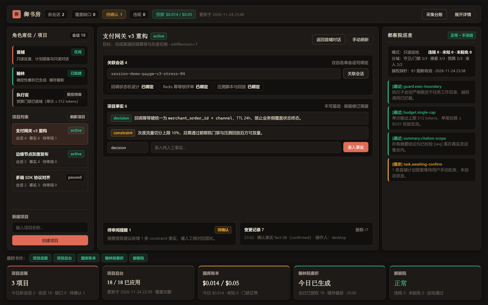
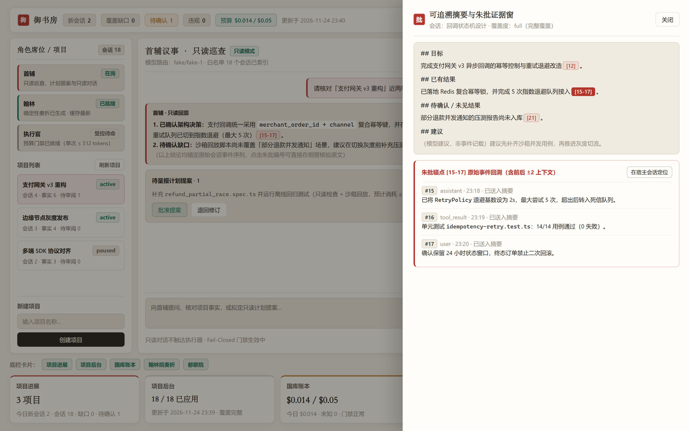

# Wangchao (dsh-wangchao)

[简体中文](README.md) | English

When your work spans dozens of AI chat windows at once, the hardest part is rarely whether the model is smart enough—it's that **context scatters everywhere, yesterday's architecture decision is buried in some forgotten thread, and you're never quite sure what the AI actually changed or spent**.

**Wangchao (王朝)** is a cross-session command-and-control system built to solve this. Currently implemented on top of **DeepSeek Harness (DSH)** through its *Imperial Study* (御书房) workspace UI, it brings your authorized sessions, project ideas, research stages, daily digests, and safety checks together in one place—giving you clarity at a glance, traceable citations for every claim, and full human control over every decision. Looking ahead, Wangchao aims to grow beyond a single host into a unified **multi-Agent management** hub.


*▲ Wangchao · Daylight Paper Theme (Imperial Study view preview with illustrative data)*

---

## What It Gives You

### 1. The Imperial Study: Clarity at a Glance, Day or Night
Stop digging through an endless flat list of chats. The Imperial Study organizes your workspace into three focused columns:
- **Left — Roles & Projects**: Track your Chief Advisor, Hanlin Archivist, and Executor seats alongside your projects, research tracks, and quick idea captures—with stage transitions, locked facts, and instant search.
- **Center — Focused Advising**: Keep the conversation centered on the current session with collapsible history, without old logs flooding your screen.
- **Top Bar & Bottom Cards**: See new sessions, pending items, budget usage, and the daily Hanlin Digest in one glance, with a clean modal viewer for full daily briefs.


*▲ The Imperial Study · Dark Ink Theme (design preview with illustrative data)*

### 2. Chief Advisor: Counsel Without Overreach
Your Chief Advisor is a **read-only strategist**, never a rogue script editing files behind your back:
- It reads only the session summaries and project facts you explicitly authorize, helping you connect dots across threads and draft actionable plans.
- **Plan adoption is strictly separated from execution**: for any proposed plan, you can independently **Adopt** (archive locally with zero model calls or background execution), **Copy task text** (take it back to your main session), or **Reject**. The real executor stays safely frozen by default.

### 3. Traceable Evidence: Zero Guesswork
Nothing is worse than an AI summary that sounds confident but can't point to where it came from:
- Every `[seq]` citation in the Chief Advisor's replies turns into a clickable anchor, opening the evidence drawer on the right so you can verify the exact source metadata.
- Project facts you confirm and **lock** cannot be silently overwritten by later summaries or model suggestions.


*▲ Clickable `[seq]` Evidence Drawer & Read-Only Verification (design preview with illustrative data)*

### 4. The Censorate: An Honest Gatekeeper
Many tools paint a green checkmark even when nothing was actually checked. The Censorate does the opposite—**if something hasn't been verified, it says so**:
- It clearly separates **Frozen**, **Abnormal**, **Unverified**, and **Normal** states.
- Whenever probes are missing, execution is unconfigured, or your authorized scope is incomplete, it honestly reports **Unverified** instead of faking a pass.

---

## Quick Start

Register the plugin in your DeepSeek Harness profile (`cordis.patch.yml`):

```yaml
- insert:
    - id: dsh-wangchao
      name: dsh-wangchao
      config:
        allowSessions: []
        allowCwds: []
        excludeCwds: []
        excludeSessions: []
        stateDir: "<DSH_HOME>/wangchao"
```

Add the directories or session IDs you want to include under `allowCwds` or `allowSessions`, restart DeepSeek Harness, and open **御书房** from the sidebar.

---

## What's Next

For now, Wangchao is focused on stabilizing its DSH-based foundation (read-only advisor, traceable ledger, separated plan adoption, and honest inspection). Looking ahead, we plan to:
- Evolve beyond a single host toward **unified multi-Agent management and coordination**;
- Gradually unlock a **controlled real executor** once strict workspace isolation and budget-audit acceptance are complete;
- Deepen **long-term project memory and research continuity** (including smoother recovery packs and cross-session handoffs).

---

## License

MIT
