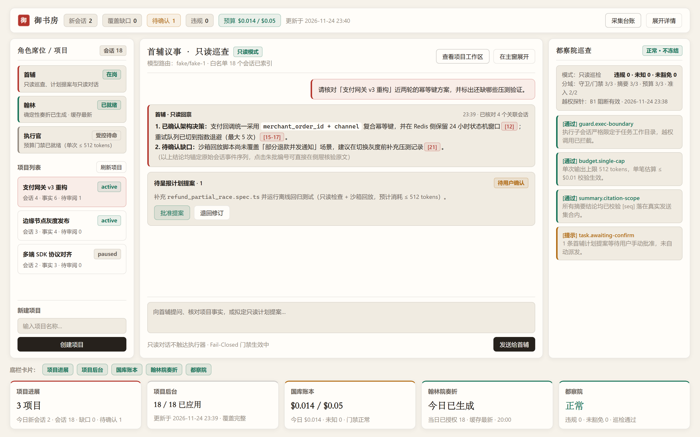
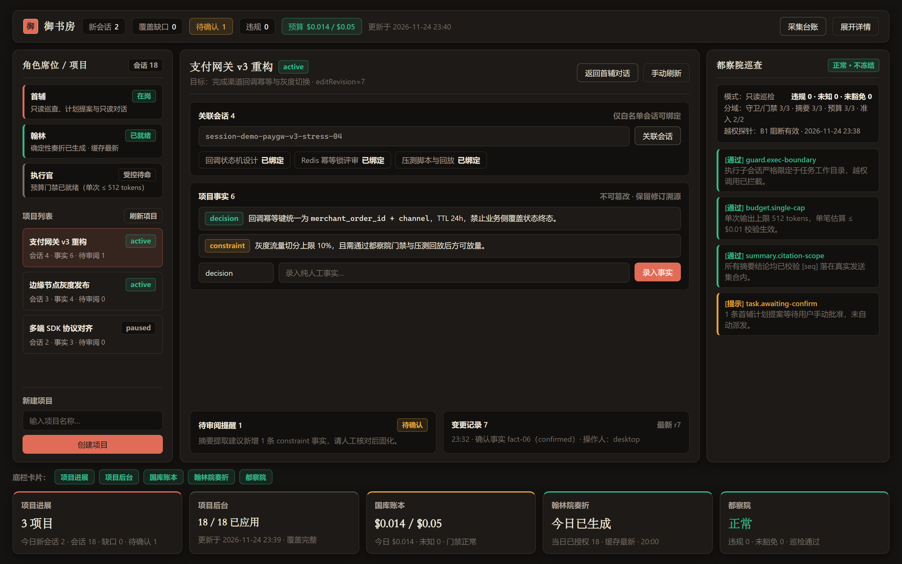
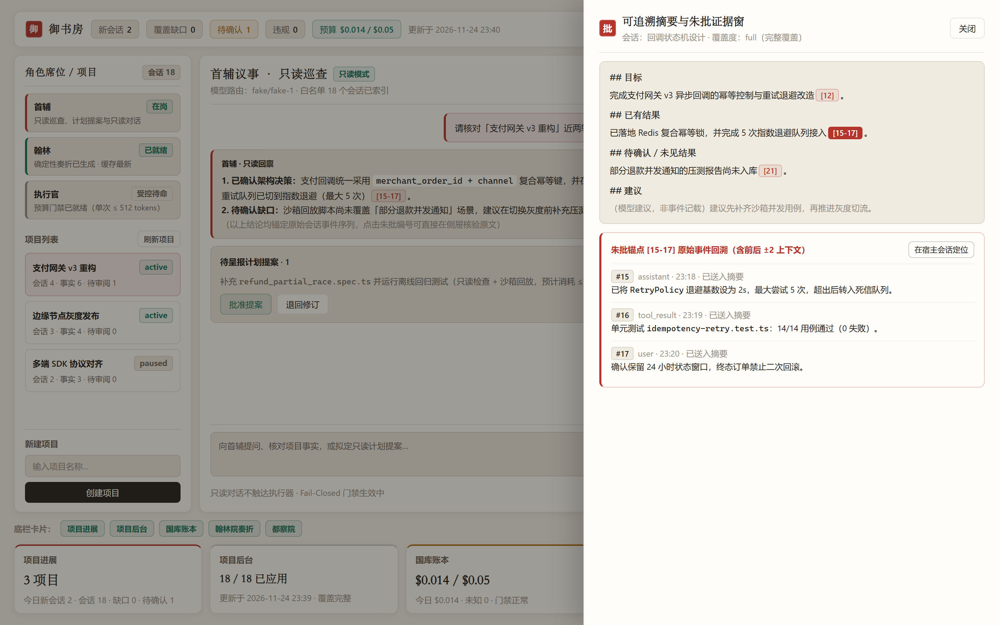

# 王朝（dsh-wangchao）

简体中文 | [English](README.en.md)

当你的工作同时横跨十几个、甚至几十个 AI 对话窗口时，最让人头疼的往往不是模型不够聪明，而是**上下文散落各处、昨天定下的架构今天忘了在哪聊过、以及你永远不敢确定 AI 到底改了什么、花掉了多少预算**。

**王朝**就是为解决这个问题而生的跨会话总控系统。目前它暂时基于 **DeepSeek Harness（DSH）** 落地实现，通过「御书房」这一交互载体，把分散在各处的授权会话、项目灵感、阶段进展、每日奏折与安全巡检收拢到一处——让你像坐镇中枢一样一眼看清全局，每一条结论都追得到原文，每一次授权都由你亲手拍板。未来，王朝也计划走出单一宿主，演进为面向**多 Agent 协同与统一治理**的管理中枢。


*▲ 王朝 · 日间纸面主题（御书房视图设计预览图，含演示数据）*

---

## 它能为你带来什么

### 1. 御书房：一眼看清全局，白天黑夜都顺眼
不再在一堆平铺直叙的会话列表里来回翻找。御书房把你的工作台收束为三栏布局：
- **左栏看席位与项目**：首辅、翰林、执行官各司其职；项目、研究与灵感快录集中管理，支持阶段流转、核心事实锁定与中文检索。
- **中栏与首辅议事**：聚焦当下议事脉络，支持一屏收拢与历史折叠，不再被陈年旧账刷屏。
- **顶栏报告条与底栏五卡**：新会话、待确认事项、预算消耗与「翰林院今日奏折」一目了然，点开即可查看完整奏折弹窗。


*▲ 御书房 · 深色暖玄墨主题（设计预览图，含演示数据）*

### 2. 内阁首辅：只谋不越权，拍板归你
首辅是你的**只读参谋**，而不是背着你乱改文件的后台脚本：
- 它只读你明确授权范围内的会话摘要与项目事实，帮你梳理脉络、回答跨会话问题、拟定行动提案。
- **计划采纳与执行授权完全分离**：面对首辅提出的计划，你可以独立选择 **「采纳」**（本地归档备忘，零模型消耗、零后台执行）、**「复制任务文本」**（带回主会话由你亲自推进），或 **「驳回」**。真实执行器默认保持冻结，绝不在未经许可时私自派发子任务。

### 3. 有据可查：每一条结论都带着门牌号
最怕 AI 自信满满地总结，却说不清依据从哪来。在御书房里：
- 首辅回复中的 `[seq]` 会自动变成可点击的朱批锚点，点开即可在右侧证据窗核对对应事件与来源，**不编造、不脑补**。
- 已经被你确认并**锁定**的项目事实，不会被后续摘要或模型建议悄悄覆写。


*▲ 朱批 `[seq]` 证据窗与只读核验视图（设计预览图，含演示数据）*

### 4. 研究工作流：灵感不会丢，隔天也能接上
对话散落不可怕，怕的是想法没有落点。御书房把研究过程当成一条可追溯的线：
- **灵感收件箱**：随手记一句，归入「待整理」；支持确认、忽略、纳入研究。同一句话重复提交会自动去重，不会堆成噪音。
- **阶段与生命周期**：火花 → 探索中 → 已验证 → 已确立，每一步变化都留时间、来源与说明；搁置、重燃、恢复都能在项目里看到完整事件记录。
- **事实分层**：用户声明、模型推断、证据支撑分开标注；已锁定的事实不会被模型或摘要改写，争议与取代关系也如实展示。
- **恢复包**：一键生成研究目标、当前阶段、已确认结论、待验假设、已排除方向、开放问题、关联会话与引用的 Markdown；只展示与复制，不自动新建会话。导出前统一脱敏凭据形态文本，默认不含会话正文。

### 5. 都察院：诚实的守门人
很多工具喜欢把“没检查”也画成绿勾，御书房恰恰相反——**看不清就直说看不清**：
- 都察院严格区分 **「已冻结」「异常」「未验证」「正常」** 四种状态。
- 只要存在未核验的探针、未启用执行策略或授权范围不完整，界面只会诚实地标出 **「未验证」**，绝不伪造通过。

---

## 快速开始

在 DeepSeek Harness 中将本插件加入你的 profile 配置（`cordis.patch.yml`）：

```yaml
- insert:
    - id: dsh-wangchao
      name: dsh-wangchao
      config:
        allowSessions: []
        allowCwds: []
        excludeCwds: []
        excludeSessions: []
        stateDir: "<DSH_HOME>/wangchao"
```

在 `allowCwds` 或 `allowSessions` 中填入你允许纳入御书房的目录或会话，重启 DeepSeek Harness 后，点击侧栏「御书房」图标即可开始使用。

**规则语义**：面板里留空某个字段并保存，表示该项**明确不授权**（不会回落到配置文件）；要恢复配置基线，点「恢复配置文件基线」删除面板覆盖。旧版本留下的空数组会按「显式空集」迁移，不会悄悄扩大采集范围。

可选运行参数（均有安全默认值，非法值会显式报错或回落默认）：

| 配置项 | 默认 | 作用 |
|---|---|---|
| `pollIntervalMs` | 30000（最小 5000） | 采集轮询间隔 |
| `maxSessionsPerPoll` | 10 | 每轮最多同步的会话数 |
| `maxAttemptsPerChild` | 2 | 执行子会话每日 attempt 上限 |
| `maxTotalTrialRequests` | 2 | 真实请求总上限（永久累计，达到后需人工核对） |
| `budgetLimitUsd` / `budgetSingleUsd` | 0 / 0.01 | 本地预算门禁的累计与单次上限（不是服务商账单） |
| `stateDir` | `<DSH_HOME>/wangchao` | 状态目录 |

---

## 后续计划

当前版本暂时基于 DeepSeek Harness 先把「只读参谋、可追溯台账、计划采纳分离与诚实巡检」打磨稳定；接下来还会继续推进：
- 逐步突破单一宿主边界，向**跨工具、多 Agent 统一管理与协同**演进；
- 在完成严格沙箱隔离与预算审计验收后，逐步解锁**受控的真实执行器**；
- 深化跨项目的**长期记忆与研究连续性**（包含更顺手的恢复包与上下文接力体验）。

---

## 许可

MIT
